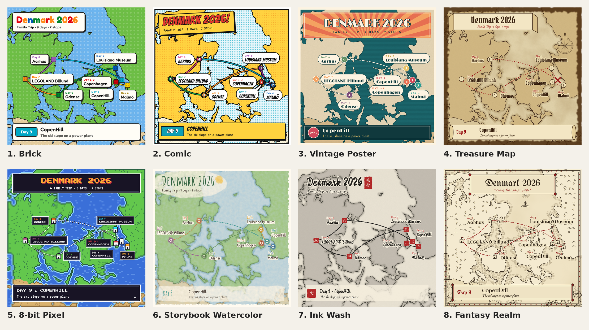
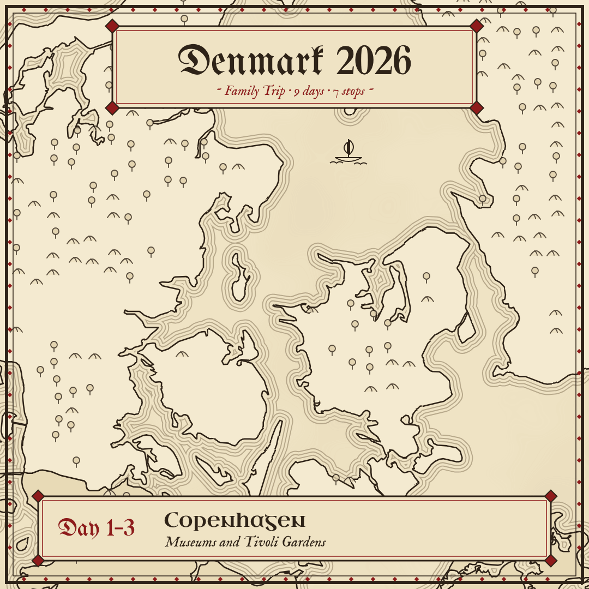
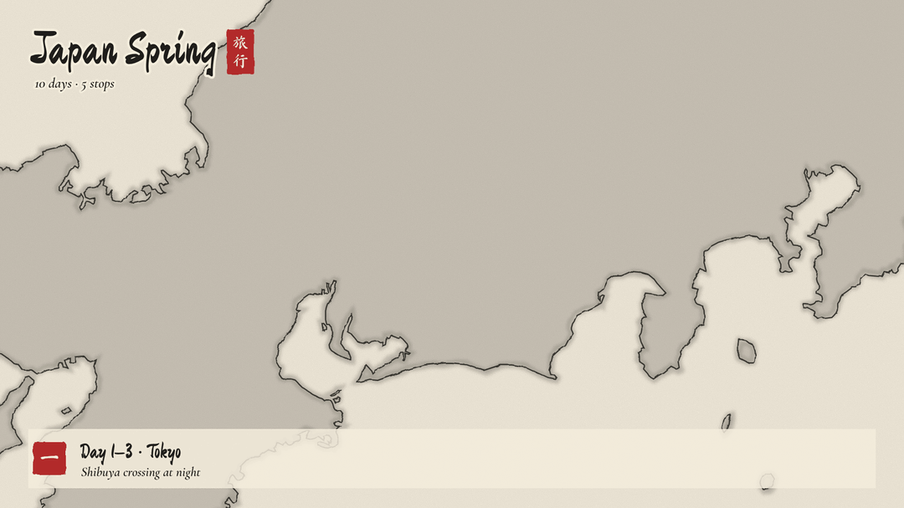

# Trip Map: a Claude skill for animated route maps

Turn any trip or journey into an animated, illustrated map. Give it a title and up to 8 stops; the route draws itself stop by stop, each stop pops onto the map, and a caption shows the day and a one-line note.

## Styles

| | Style | Look |
|---|---|---|
| 1 | **Brick** | Toy-brick colours on a studded baseplate |
| 2 | **Comic** | Halftone dots, heavy ink, speech bubbles, action bursts |
| 3 | **Vintage Poster** | 1950s travel poster, sunburst title, plane on a flight path |
| 4 | **Treasure Map** | Stained parchment, burnt edges, compass rose, red X |
| 5 | **8-bit Pixel** | Pixel-art game world map with a walking traveller |
| 6 | **Storybook Watercolor** | Soft painted washes on textured paper |
| 7 | **Ink Wash 水墨** | Chinese ink painting with red seals |
| 8 | **Fantasy Realm** | Hand-inked fantasy atlas with castles and water lining |

## Examples

| Fantasy Realm (square) | Ink Wash (wide) |
|---|---|
|  |  |

## What it does

- **Input:** a title, 2–8 stops in travel order, optional day/date and one-line note per stop.
- **Choices:** style, shape (square, wide 16:9, vertical 9:16), real coastlines or a plain background.
- **Output:** GIF, MP4, self-contained HTML, or a PNG picture.
- Real coastlines from Natural Earth, automatically zoomed to the route; labels place themselves to avoid collisions.

## Install

1. Download [`SKILL.md`](SKILL.md).
2. Add it to your Claude skills (for example by asking Claude to save it as a skill).
3. Ask Claude: *"Make a trip map of my trip: Tokyo, Hakone, Kyoto, Nara, Osaka."*

It needs an environment where Claude can run code (Node, Python, ffmpeg and a headless browser). Everything else is installed by the skill itself.

## Limits

- Coastline maps, not satellite or street maps.
- Up to 8 stops; labels in Latin script.
- Routes crossing the Pacific date line aren't supported; split them into two maps.

## Credits

- Coastline data: [Natural Earth](https://www.naturalearthdata.com/) (public domain) via [world-atlas](https://github.com/topojson/world-atlas).
- Map projection: [d3-geo](https://github.com/d3/d3-geo).
- Fonts: Google Fonts (SIL Open Font License) via [Fontsource](https://fontsource.org/).

Made by 雪雪 (Snow) with Claude.
